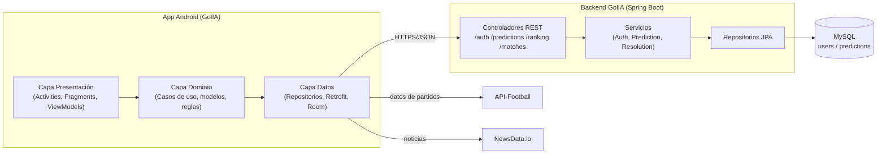
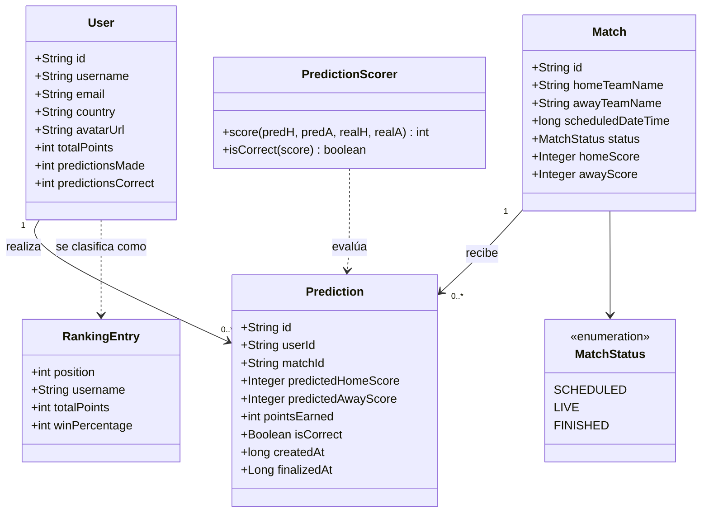
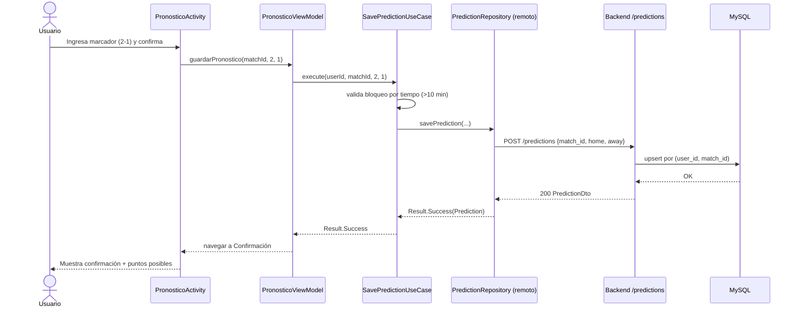
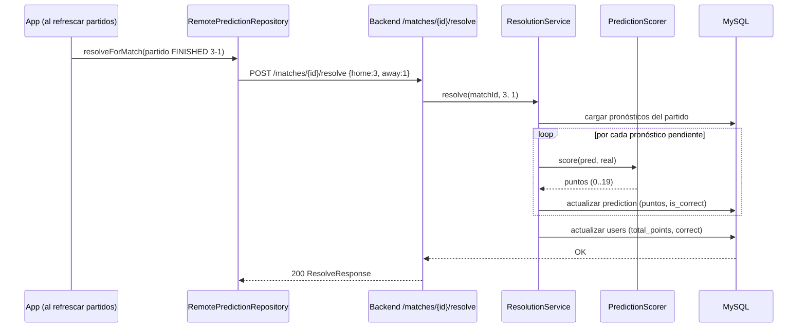
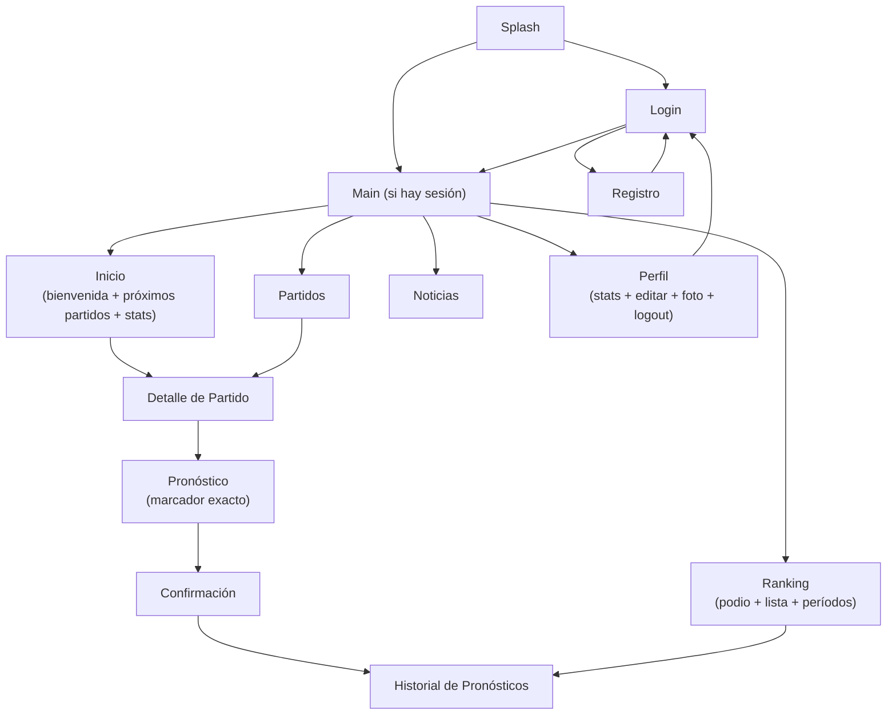
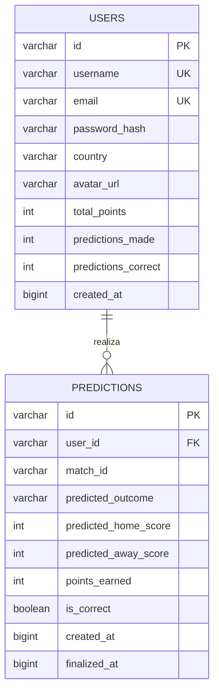

# Documento de Diseño: UML + GUI
## Aplicación GolIA — Pronósticos de Fútbol

**Autor:** [Tu Nombre] — Estudiante de Desarrollo de Software
**Fecha:** 2026

> Los diagramas usan sintaxis **Mermaid** y **PlantUML/ASCII**. Se renderizan en editores compatibles (VS Code con extensión Mermaid, GitHub, etc.).

---

## 1. Arquitectura general (diagrama de componentes)

---

## 2. Diagrama de clases (dominio simplificado)

---

## 3. Diagrama de secuencia: Realizar pronóstico (CU-06)

---

## 4. Diagrama de secuencia: Resolución de puntos (CU transversal RF-16/17)

---

## 5. Diagrama de navegación (flujo de pantallas)

---

## 6. Modelo entidad-relación (base de datos MySQL)

> Restricción: índice único `(user_id, match_id)` → un pronóstico por usuario y partido.

---

## 7. Diseño de la Interfaz Gráfica (GUI)

### 7.1 Mapa de pantallas

| Pantalla | Archivo layout | Función principal |
|---|---|---|
| Splash | `activity_splash.xml` | Carga inicial y decisión de sesión. |
| Login | `activity_login.xml` | Autenticación. |
| Registro | `activity_registro.xml` | Alta de cuenta. |
| Main (contenedor) | `activity_main.xml` | Barra de navegación inferior. |
| Inicio | `fragment_inicio.xml` | Bienvenida, estadísticas y próximos partidos. |
| Partidos | `fragment_partidos.xml` | Lista de partidos. |
| Ranking | `fragment_ranking.xml` | Podio, lista y filtro por período + historial. |
| Noticias | `fragment_noticias.xml` | Feed de noticias. |
| Perfil | `fragment_perfil.xml` | Estadísticas, edición, foto y logout. |
| Detalle de partido | `activity_detalle_partido.xml` | Información del partido. |
| Pronóstico | `activity_pronostico.xml` | Ingreso de marcador. |
| Confirmación | `activity_confirmacion.xml` | Resumen del pronóstico. |
| Historial | `activity_historial_pronosticos.xml` | Lista de pronósticos. |

### 7.2 Principios de diseño aplicados
- **Material Design** con paleta oscura azul.
- **Navegación por barra inferior** de 5 secciones.
- **Estados visuales**: carga (progress), vacío (mensaje), error (reintentar).
- **Jerarquía visual** en el ranking: podio destacado + lista.
- **Accesibilidad**: descripciones de contenido en íconos e imágenes.

### 7.3 Wireframes
Los wireframes de las pantallas principales se incluyen como artefactos visuales adjuntos (ver `wireframes_golia.svg`).
